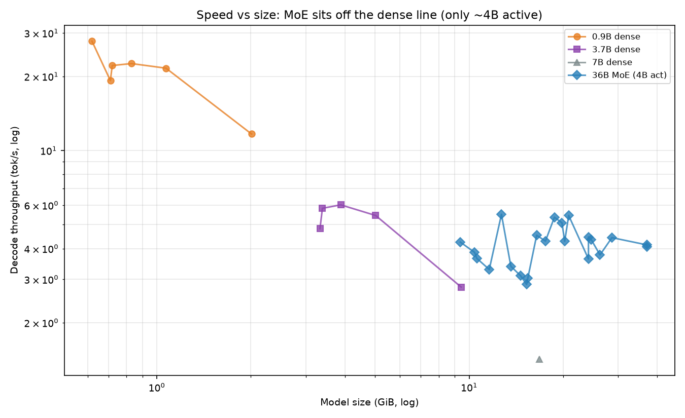
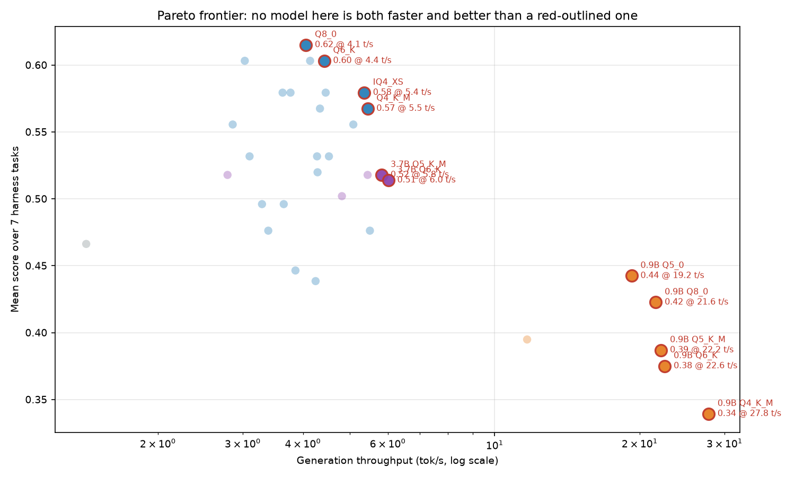

# K2-Horizon CPU quality evaluation — cross-model summary

Quality and CPU throughput for every GGUF build of the K2-Horizon family evaluated on a CPU-only host with the IFM K2-Horizon llama.cpp backend: **36B MoE (4B active)**, plus the dense **3.7B**, **0.9B** and **7B** siblings.

- **41 models** with scores · 8 lm-eval tasks · 12 samples/task · 1 fixed throughput probe each
- Host: 8-thread Intel Xeon E5 (Sandy Bridge-E), 62 GiB DDR3, **no GPU**
- Harness: EleutherAI `lm-eval` 0.4.13 over Lemonade's OpenAI-compatible endpoint

> **Read this first.** n=12 per task gives a per-task standard error of roughly ±0.08–0.15, so the 7-task mean carries about ±0.03–0.05. Differences smaller than that are **not resolved by this study**. The top of the table is a statistical tie, and nothing here claims otherwise.

This is a `cpu_quality_eval` dataset — accuracy plus single-stream CPU throughput. It is **not** a GPU throughput sweep and is not comparable to the `perf-data-*` series in this repository.

## Ranking by mean score

| # | Model | Family | Size | mean (7 tasks) | decode tok/s | vs 7B |
|---:|---|---|---|---|---|---|
| 1 | [Q8_0](eval-data-mova36b-a4b-q8-0/README.md) | 36B MoE (4B active) | 37.10 GiB | **.615** | 4.06 | +0.149 |
| 2 | [FP8-Q8_0 (IFM-direct baseline)](eval-data-mova36b-a4b-fp8-q8-0/README.md) | 36B MoE (4B active) | 37.10 GiB | **.603** | 4.14 | +0.137 |
| 3 | [IQ3_M](eval-data-mova36b-a4b-iq3-m/README.md) | 36B MoE (4B active) | 15.41 GiB | **.603** | 3.03 | +0.137 |
| 4 | [Q6_K](eval-data-mova36b-a4b-q6-k/README.md) | 36B MoE (4B active) | 28.65 GiB | **.603** | 4.43 | +0.137 |
| 5 | [IQ4_XS](eval-data-mova36b-a4b-iq4-xs/README.md) | 36B MoE (4B active) | 18.75 GiB | **.579** | 5.36 | +0.113 |
| 6 | [Q4_0](eval-data-mova36b-a4b-q4-0/README.md) | 36B MoE (4B active) | 19.82 GiB | **.579** | 5.48 | +0.113 |
| 7 | [Q5_0](eval-data-mova36b-a4b-q5-0/README.md) | 36B MoE (4B active) | 24.10 GiB | **.579** | 3.63 | +0.113 |
| 8 | [Q5_1](eval-data-mova36b-a4b-q5-1/README.md) | 36B MoE (4B active) | 26.24 GiB | **.579** | 3.77 | +0.113 |
| 9 | [Q5_K_S](eval-data-mova36b-a4b-q5-k-s/README.md) | 36B MoE (4B active) | 24.10 GiB | **.579** | 4.46 | +0.113 |
| 10 | [Q4_K_M](eval-data-mova36b-a4b-q4-k-m/README.md) | 36B MoE (4B active) | 20.83 GiB | **.568** | 5.45 | +0.101 |
| 11 | [Q4_K_S](eval-data-mova36b-a4b-q4-k-s/README.md) | 36B MoE (4B active) | 19.89 GiB | **.568** | 4.68 | +0.101 |
| 12 | [Q5_K_M](eval-data-mova36b-a4b-q5-k-m/README.md) | 36B MoE (4B active) | 24.62 GiB | **.568** | 4.34 | +0.101 |
| 13 | [IQ3_S](eval-data-mova36b-a4b-iq3-s/README.md) | 36B MoE (4B active) | 15.27 GiB | **.556** | 2.86 | +0.090 |
| 14 | [IQ4_NL](eval-data-mova36b-a4b-iq4-nl/README.md) | 36B MoE (4B active) | 19.82 GiB | **.556** | 5.09 | +0.090 |
| 15 | [Q3_K_S](eval-data-mova36b-a4b-q3-k-s/README.md) | 36B MoE (4B active) | 15.27 GiB | **.544** | 3.58 | +0.078 |
| 16 | [IQ3_XS](eval-data-mova36b-a4b-iq3-xs/README.md) | 36B MoE (4B active) | 14.62 GiB | **.532** | 3.1 | +0.066 |
| 17 | [MXFP4_MOE](eval-data-mova36b-a4b-mxfp4-moe/README.md) | 36B MoE (4B active) | 20.23 GiB | **.532** | 4.28 | +0.066 |
| 18 | [Q3_K_M](eval-data-mova36b-a4b-q3-k-m/README.md) | 36B MoE (4B active) | 16.45 GiB | **.532** | 4.53 | +0.066 |
| 19 | [Q3_K_L](eval-data-mova36b-a4b-q3-k-l/README.md) | 36B MoE (4B active) | 17.55 GiB | **.520** | 4.29 | +0.054 |
| 20 | [Q4_1](eval-data-mova36b-a4b-q4-1/README.md) | 36B MoE (4B active) | 21.96 GiB | **.520** | 4.5 | +0.054 |
| 21 | [3.7B BF16](eval-data-k2horizon-3.7b-bf16/README.md) | 3.7B dense | 9.43 GiB | **.518** | 2.79 | +0.052 |
| 22 | [3.7B Q5_K_M](eval-data-k2horizon-3.7b-q5-k-m/README.md) | 3.7B dense | 3.39 GiB | **.518** | 5.83 | +0.052 |
| 23 | [3.7B Q8_0](eval-data-k2horizon-3.7b-q8-0/README.md) | 3.7B dense | 5.02 GiB | **.518** | 5.45 | +0.052 |
| 24 | [3.7B Q6_K](eval-data-k2horizon-3.7b-q6-k/README.md) | 3.7B dense | 3.88 GiB | **.514** | 6.02 | +0.048 |
| 25 | [3.7B Q5_0](eval-data-k2horizon-3.7b-q5-0/README.md) | 3.7B dense | 3.33 GiB | **.502** | 4.82 | +0.036 |
| 26 | [IQ2_M](eval-data-mova36b-a4b-iq2-m/README.md) | 36B MoE (4B active) | 11.60 GiB | **.496** | 3.29 | +0.030 |
| 27 | [IQ2_S](eval-data-mova36b-a4b-iq2-s/README.md) | 36B MoE (4B active) | 10.58 GiB | **.496** | 3.65 | +0.030 |
| 28 | [IQ3_XXS](eval-data-mova36b-a4b-iq3-xxs/README.md) | 36B MoE (4B active) | 13.60 GiB | **.476** | 3.39 | +0.010 |
| 29 | [Q2_K](eval-data-mova36b-a4b-q2-k/README.md) | 36B MoE (4B active) | 12.69 GiB | **.476** | 5.51 | +0.010 |
| 30 | [7B BF16 (baseline)](eval-data-k2horizon-7b-bf16/README.md) | 7B dense | 16.80 GiB | **.466** | 1.42 | — |
| 31 | [IQ2_XS](eval-data-mova36b-a4b-iq2-xs/README.md) | 36B MoE (4B active) | 10.41 GiB | **.446** | 3.86 | -0.020 |
| 32 | [0.9B Q5_0](eval-data-k2horizon-0.9b-q5-0/README.md) | 0.9B dense | 0.71 GiB | **.443** | 19.25 | -0.024 |
| 33 | [IQ2_XXS](eval-data-mova36b-a4b-iq2-xxs/README.md) | 36B MoE (4B active) | 9.37 GiB | **.439** | 4.25 | -0.028 |
| 34 | [0.9B Q8_0](eval-data-k2horizon-0.9b-q8-0/README.md) | 0.9B dense | 1.07 GiB | **.423** | 21.61 | -0.043 |
| 35 | [0.9B BF16](eval-data-k2horizon-0.9b-bf16/README.md) | 0.9B dense | 2.01 GiB | **.395** | 11.68 | -0.071 |
| 36 | [0.9B Q5_K_M](eval-data-k2horizon-0.9b-q5-k-m/README.md) | 0.9B dense | 0.72 GiB | **.387** | 22.16 | -0.079 |
| 37 | [0.9B Q6_K](eval-data-k2horizon-0.9b-q6-k/README.md) | 0.9B dense | 0.83 GiB | **.375** | 22.56 | -0.091 |
| 38 | [0.9B Q4_K_M](eval-data-k2horizon-0.9b-q4-k-m/README.md) | 0.9B dense | 0.62 GiB | **.339** | 27.82 | -0.127 |
| 39 | [IQ1_M](eval-data-mova36b-a4b-iq1-m/README.md) | 36B MoE (4B active) | 8.10 GiB | **.280** | 2.59 | -0.186 |
| 40 | [IQ1_S](eval-data-mova36b-a4b-iq1-s/README.md) | 36B MoE (4B active) | 7.30 GiB | **.212** | 3.64 | -0.254 |
| 41 | [Q1_0](eval-data-mova36b-a4b-q1-0/README.md) | 36B MoE (4B active) | 5.40 GiB | **.012** | — | -0.454 |

## Full score matrix

| Model | human | mbpp | gsm8k | coqa | squad | ifeval | toolcall | seg | mean |
|---|---|---|---|---|---|---|---|---|---|
| [Q8_0](eval-data-mova36b-a4b-q8-0/README.md) | .750 | .583 | .917 | .722 | .833 | .250 | .250 | .000 | **.615** |
| [FP8-Q8_0 (IFM-direct baseline)](eval-data-mova36b-a4b-fp8-q8-0/README.md) | .833 | .667 | .917 | .722 | .667 | .250 | .167 | .000 | **.603** |
| [IQ3_M](eval-data-mova36b-a4b-iq3-m/README.md) | .750 | .583 | 1.000 | .722 | .667 | .167 | .333 | .000 | **.603** |
| [Q6_K](eval-data-mova36b-a4b-q6-k/README.md) | .667 | .667 | .917 | .722 | .750 | .167 | .333 | .000 | **.603** |
| [IQ4_XS](eval-data-mova36b-a4b-iq4-xs/README.md) | .917 | .667 | .750 | .722 | .583 | .083 | .333 | .000 | **.579** |
| [Q4_0](eval-data-mova36b-a4b-q4-0/README.md) | .833 | .583 | .750 | .722 | .917 | .083 | .167 | .000 | **.579** |
| [Q5_0](eval-data-mova36b-a4b-q5-0/README.md) | .667 | .667 | .833 | .722 | .667 | .167 | .333 | .000 | **.579** |
| [Q5_1](eval-data-mova36b-a4b-q5-1/README.md) | .750 | .833 | .917 | .722 | .667 | .083 | .083 | .000 | **.579** |
| [Q5_K_S](eval-data-mova36b-a4b-q5-k-s/README.md) | .583 | .667 | .917 | .722 | .750 | .250 | .167 | .000 | **.579** |
| [Q4_K_M](eval-data-mova36b-a4b-q4-k-m/README.md) | .833 | .583 | .833 | .639 | .833 | .167 | .083 | .000 | **.568** |
| [Q4_K_S](eval-data-mova36b-a4b-q4-k-s/README.md) | .833 | .667 | .750 | .722 | .667 | .167 | .167 | .000 | **.568** |
| [Q5_K_M](eval-data-mova36b-a4b-q5-k-m/README.md) | .833 | .500 | .833 | .722 | .667 | .250 | .167 | .000 | **.568** |
| [IQ3_S](eval-data-mova36b-a4b-iq3-s/README.md) | .833 | .500 | .917 | .639 | .583 | .250 | .167 | .000 | **.556** |
| [IQ4_NL](eval-data-mova36b-a4b-iq4-nl/README.md) | .917 | .667 | .833 | .722 | .667 | .083 | .000 | .000 | **.556** |
| [Q3_K_S](eval-data-mova36b-a4b-q3-k-s/README.md) | .833 | .667 | .833 | .639 | .667 | .167 | .000 | .000 | **.544** |
| [IQ3_XS](eval-data-mova36b-a4b-iq3-xs/README.md) | .750 | .500 | .750 | .722 | .583 | .167 | .250 | .000 | **.532** |
| [MXFP4_MOE](eval-data-mova36b-a4b-mxfp4-moe/README.md) | .583 | .500 | 1.000 | .722 | .667 | .167 | .083 | .000 | **.532** |
| [Q3_K_M](eval-data-mova36b-a4b-q3-k-m/README.md) | .750 | .417 | .833 | .639 | .833 | .250 | .000 | .000 | **.532** |
| [Q3_K_L](eval-data-mova36b-a4b-q3-k-l/README.md) | .667 | .500 | .917 | .639 | .750 | .167 | .000 | .000 | **.520** |
| [Q4_1](eval-data-mova36b-a4b-q4-1/README.md) | .667 | .583 | .833 | .722 | .583 | .250 | .000 | .000 | **.520** |
| [3.7B BF16](eval-data-k2horizon-3.7b-bf16/README.md) | .667 | .667 | .833 | .542 | .833 | .083 | .000 | .000 | **.518** |
| [3.7B Q5_K_M](eval-data-k2horizon-3.7b-q5-k-m/README.md) | .667 | .583 | .750 | .542 | 1.000 | .083 | .000 | .000 | **.518** |
| [3.7B Q8_0](eval-data-k2horizon-3.7b-q8-0/README.md) | .750 | .667 | .750 | .542 | .833 | .083 | .000 | .000 | **.518** |
| [3.7B Q6_K](eval-data-k2horizon-3.7b-q6-k/README.md) | .750 | .583 | .750 | .597 | .833 | .083 | .000 | .000 | **.514** |
| [3.7B Q5_0](eval-data-k2horizon-3.7b-q5-0/README.md) | .833 | .667 | .583 | .597 | .667 | .167 | .000 | .000 | **.502** |
| [IQ2_M](eval-data-mova36b-a4b-iq2-m/README.md) | .583 | .417 | .750 | .639 | .750 | .083 | .250 | .000 | **.496** |
| [IQ2_S](eval-data-mova36b-a4b-iq2-s/README.md) | .417 | .500 | 1.000 | .639 | .750 | .167 | .000 | .000 | **.496** |
| [IQ3_XXS](eval-data-mova36b-a4b-iq3-xxs/README.md) | .583 | .417 | .833 | .583 | .750 | .167 | .000 | .000 | **.476** |
| [Q2_K](eval-data-mova36b-a4b-q2-k/README.md) | .500 | .500 | .667 | .583 | .917 | .167 | .000 | .000 | **.476** |
| [7B BF16 (baseline)](eval-data-k2horizon-7b-bf16/README.md) | .750 | .333 | .583 | .597 | .667 | .083 | .250 | .000 | **.466** |
| [IQ2_XS](eval-data-mova36b-a4b-iq2-xs/README.md) | .583 | .417 | .667 | .542 | .833 | .083 | .000 | .000 | **.446** |
| [0.9B Q5_0](eval-data-k2horizon-0.9b-q5-0/README.md) | .583 | .500 | .417 | .597 | .750 | .083 | .167 | .000 | **.443** |
| [IQ2_XXS](eval-data-mova36b-a4b-iq2-xxs/README.md) | .583 | .583 | .417 | .403 | .833 | .250 | .000 | .000 | **.439** |
| [0.9B Q8_0](eval-data-k2horizon-0.9b-q8-0/README.md) | .417 | .417 | .583 | .542 | .667 | .167 | .167 | .000 | **.423** |
| [0.9B BF16](eval-data-k2horizon-0.9b-bf16/README.md) | .417 | .500 | .417 | .597 | .750 | .083 | .000 | .000 | **.395** |
| [0.9B Q5_K_M](eval-data-k2horizon-0.9b-q5-k-m/README.md) | .333 | .333 | .583 | .542 | .750 | .083 | .083 | .000 | **.387** |
| [0.9B Q6_K](eval-data-k2horizon-0.9b-q6-k/README.md) | .417 | .500 | .333 | .542 | .750 | .000 | .083 | .000 | **.375** |
| [0.9B Q4_K_M](eval-data-k2horizon-0.9b-q4-k-m/README.md) | .417 | .250 | .333 | .542 | .750 | .000 | .083 | .000 | **.339** |
| [IQ1_M](eval-data-mova36b-a4b-iq1-m/README.md) | .250 | .333 | .167 | .292 | .833 | .083 | .000 | .000 | **.280** |
| [IQ1_S](eval-data-mova36b-a4b-iq1-s/README.md) | .250 | .083 | .083 | .236 | .667 | .167 | .000 | .000 | **.212** |
| [Q1_0](eval-data-mova36b-a4b-q1-0/README.md) | .000 | .000 | .000 | .000 | .000 | .083 | .000 | .000 | **.012** |

`seg` (BIG-bench paragraph segmentation) scored 0.00 for every model including the FP8 baseline and is excluded from the mean.

## Throughput

Fixed prompt, temperature 0, 64 generated tokens, 8 threads, one model loaded at a time.

| Model | Size | decode tok/s | prefill tok/s |
|---|---|---|---|
| [7B BF16 (baseline)](eval-data-k2horizon-7b-bf16/README.md) | 16.80 GiB | 1.42 | 2.4 |
| [IQ1_M](eval-data-mova36b-a4b-iq1-m/README.md) | 8.10 GiB | 2.59 | 3.1 |
| [3.7B BF16](eval-data-k2horizon-3.7b-bf16/README.md) | 9.43 GiB | 2.79 | 4.8 |
| [IQ3_S](eval-data-mova36b-a4b-iq3-s/README.md) | 15.27 GiB | 2.86 | 3.5 |
| [IQ3_M](eval-data-mova36b-a4b-iq3-m/README.md) | 15.41 GiB | 3.03 | 3.8 |
| [IQ3_XS](eval-data-mova36b-a4b-iq3-xs/README.md) | 14.62 GiB | 3.1 | 3.8 |
| [IQ2_M](eval-data-mova36b-a4b-iq2-m/README.md) | 11.60 GiB | 3.29 | 4.0 |
| [IQ3_XXS](eval-data-mova36b-a4b-iq3-xxs/README.md) | 13.60 GiB | 3.39 | 4.4 |
| [Q3_K_S](eval-data-mova36b-a4b-q3-k-s/README.md) | 15.27 GiB | 3.58 | 5.0 |
| [Q5_0](eval-data-mova36b-a4b-q5-0/README.md) | 24.10 GiB | 3.63 | 5.7 |
| [IQ1_S](eval-data-mova36b-a4b-iq1-s/README.md) | 7.30 GiB | 3.64 | 4.7 |
| [IQ2_S](eval-data-mova36b-a4b-iq2-s/README.md) | 10.58 GiB | 3.65 | 5.1 |
| [Q5_1](eval-data-mova36b-a4b-q5-1/README.md) | 26.24 GiB | 3.77 | 5.1 |
| [IQ2_XS](eval-data-mova36b-a4b-iq2-xs/README.md) | 10.41 GiB | 3.86 | 5.5 |
| [Q8_0](eval-data-mova36b-a4b-q8-0/README.md) | 37.10 GiB | 4.06 | 7.8 |
| [FP8-Q8_0 (IFM-direct baseline)](eval-data-mova36b-a4b-fp8-q8-0/README.md) | 37.10 GiB | 4.14 | 8.2 |
| [IQ2_XXS](eval-data-mova36b-a4b-iq2-xxs/README.md) | 9.37 GiB | 4.25 | 5.8 |
| [MXFP4_MOE](eval-data-mova36b-a4b-mxfp4-moe/README.md) | 20.23 GiB | 4.28 | 8.3 |
| [Q3_K_L](eval-data-mova36b-a4b-q3-k-l/README.md) | 17.55 GiB | 4.29 | 6.1 |
| [Q5_K_M](eval-data-mova36b-a4b-q5-k-m/README.md) | 24.62 GiB | 4.34 | 6.5 |
| [Q6_K](eval-data-mova36b-a4b-q6-k/README.md) | 28.65 GiB | 4.43 | 7.7 |
| [Q5_K_S](eval-data-mova36b-a4b-q5-k-s/README.md) | 24.10 GiB | 4.46 | 6.5 |
| [Q4_1](eval-data-mova36b-a4b-q4-1/README.md) | 21.96 GiB | 4.5 | 6.5 |
| [Q3_K_M](eval-data-mova36b-a4b-q3-k-m/README.md) | 16.45 GiB | 4.53 | 6.7 |
| [Q4_K_S](eval-data-mova36b-a4b-q4-k-s/README.md) | 19.89 GiB | 4.68 | 7.6 |
| [3.7B Q5_0](eval-data-k2horizon-3.7b-q5-0/README.md) | 3.33 GiB | 4.82 | 9.1 |
| [IQ4_NL](eval-data-mova36b-a4b-iq4-nl/README.md) | 19.82 GiB | 5.09 | 7.8 |
| [IQ4_XS](eval-data-mova36b-a4b-iq4-xs/README.md) | 18.75 GiB | 5.36 | 8.6 |
| [3.7B Q8_0](eval-data-k2horizon-3.7b-q8-0/README.md) | 5.02 GiB | 5.45 | 12.4 |
| [Q4_K_M](eval-data-mova36b-a4b-q4-k-m/README.md) | 20.83 GiB | 5.45 | 9.1 |
| [Q4_0](eval-data-mova36b-a4b-q4-0/README.md) | 19.82 GiB | 5.48 | 8.8 |
| [Q2_K](eval-data-mova36b-a4b-q2-k/README.md) | 12.69 GiB | 5.51 | 8.6 |
| [3.7B Q5_K_M](eval-data-k2horizon-3.7b-q5-k-m/README.md) | 3.39 GiB | 5.83 | 9.0 |
| [3.7B Q6_K](eval-data-k2horizon-3.7b-q6-k/README.md) | 3.88 GiB | 6.02 | 10.8 |
| [0.9B BF16](eval-data-k2horizon-0.9b-bf16/README.md) | 2.01 GiB | 11.68 | 20.3 |
| [0.9B Q5_0](eval-data-k2horizon-0.9b-q5-0/README.md) | 0.71 GiB | 19.25 | 38.6 |
| [0.9B Q8_0](eval-data-k2horizon-0.9b-q8-0/README.md) | 1.07 GiB | 21.61 | 52.0 |
| [0.9B Q5_K_M](eval-data-k2horizon-0.9b-q5-k-m/README.md) | 0.72 GiB | 22.16 | 35.9 |
| [0.9B Q6_K](eval-data-k2horizon-0.9b-q6-k/README.md) | 0.83 GiB | 22.56 | 43.2 |
| [0.9B Q4_K_M](eval-data-k2horizon-0.9b-q4-k-m/README.md) | 0.62 GiB | 27.82 | 46.9 |

Throughput is the weakest part of this dataset: a single 64-token sample per model with no repeats, so differences under ~10% are noise.

## Findings

1. **The 36B MoE is the quality ceiling.** Every MoVA quant from ~15 GiB up matches or beats every dense sibling; the best dense model is the 3.7B.
2. **Quality is flat across the upper ladder.** IQ4_XS (18.7 GiB) through Q8_0 (37.1 GiB) sit inside a ~0.05 band — within the noise floor. Larger quants buy disk, not accuracy.
3. **The dense 3.7B beats the dense 7B** (mean .518 vs .466) with 44% fewer parameters, so the family does not scale monotonically in dense parameters. At n=12 that gap is ~1σ, so treat it as suggestive rather than settled.
4. **Quantization is free at 3.7B.** All six builds land within 0.016 of each other — take Q5_K_M at 3.4 GiB rather than BF16 at 9.4 GiB.
5. **Tool-calling is a model-family property, not a quantization artifact.** Several MoVA quants score exactly 0.00, and the 3.7B scores 0.00 at *every* precision including BF16, while the 7B manages 0.25.
6. **MoE breaks the speed-vs-size line.** Dense speed tracks total parameters (0.9B → 27.8 tok/s, 7B → 1.4 tok/s); the 36B MoE carries 10× the parameters of the 3.7B and still decodes ~2× faster than the 7B.

## Per-model datasets

Each model ships its own PR and directory containing the raw dataset, the per-test report, a chart, a manifest and a gate record. Machine-readable index: [`eval-data-index.json`](eval-data-index.json).

| Slug | Model | PR |
|---|---|---|
| `mova36b-a4b-q8-0` | Q8_0 | see repo PR list, head `eval/mova36b-a4b-q8-0` |
| `mova36b-a4b-fp8-q8-0` | FP8-Q8_0 (IFM-direct baseline) | see repo PR list, head `eval/mova36b-a4b-fp8-q8-0` |
| `mova36b-a4b-iq3-m` | IQ3_M | see repo PR list, head `eval/mova36b-a4b-iq3-m` |
| `mova36b-a4b-q6-k` | Q6_K | see repo PR list, head `eval/mova36b-a4b-q6-k` |
| `mova36b-a4b-iq4-xs` | IQ4_XS | see repo PR list, head `eval/mova36b-a4b-iq4-xs` |
| `mova36b-a4b-q4-0` | Q4_0 | see repo PR list, head `eval/mova36b-a4b-q4-0` |
| `mova36b-a4b-q5-0` | Q5_0 | see repo PR list, head `eval/mova36b-a4b-q5-0` |
| `mova36b-a4b-q5-1` | Q5_1 | see repo PR list, head `eval/mova36b-a4b-q5-1` |
| `mova36b-a4b-q5-k-s` | Q5_K_S | see repo PR list, head `eval/mova36b-a4b-q5-k-s` |
| `mova36b-a4b-q4-k-m` | Q4_K_M | see repo PR list, head `eval/mova36b-a4b-q4-k-m` |
| `mova36b-a4b-q4-k-s` | Q4_K_S | see repo PR list, head `eval/mova36b-a4b-q4-k-s` |
| `mova36b-a4b-q5-k-m` | Q5_K_M | see repo PR list, head `eval/mova36b-a4b-q5-k-m` |
| `mova36b-a4b-iq3-s` | IQ3_S | see repo PR list, head `eval/mova36b-a4b-iq3-s` |
| `mova36b-a4b-iq4-nl` | IQ4_NL | see repo PR list, head `eval/mova36b-a4b-iq4-nl` |
| `mova36b-a4b-q3-k-s` | Q3_K_S | see repo PR list, head `eval/mova36b-a4b-q3-k-s` |
| `mova36b-a4b-iq3-xs` | IQ3_XS | see repo PR list, head `eval/mova36b-a4b-iq3-xs` |
| `mova36b-a4b-mxfp4-moe` | MXFP4_MOE | see repo PR list, head `eval/mova36b-a4b-mxfp4-moe` |
| `mova36b-a4b-q3-k-m` | Q3_K_M | see repo PR list, head `eval/mova36b-a4b-q3-k-m` |
| `mova36b-a4b-q3-k-l` | Q3_K_L | see repo PR list, head `eval/mova36b-a4b-q3-k-l` |
| `mova36b-a4b-q4-1` | Q4_1 | see repo PR list, head `eval/mova36b-a4b-q4-1` |
| `k2horizon-3.7b-bf16` | 3.7B BF16 | see repo PR list, head `eval/k2horizon-3.7b-bf16` |
| `k2horizon-3.7b-q5-k-m` | 3.7B Q5_K_M | see repo PR list, head `eval/k2horizon-3.7b-q5-k-m` |
| `k2horizon-3.7b-q8-0` | 3.7B Q8_0 | see repo PR list, head `eval/k2horizon-3.7b-q8-0` |
| `k2horizon-3.7b-q6-k` | 3.7B Q6_K | see repo PR list, head `eval/k2horizon-3.7b-q6-k` |
| `k2horizon-3.7b-q5-0` | 3.7B Q5_0 | see repo PR list, head `eval/k2horizon-3.7b-q5-0` |
| `mova36b-a4b-iq2-m` | IQ2_M | see repo PR list, head `eval/mova36b-a4b-iq2-m` |
| `mova36b-a4b-iq2-s` | IQ2_S | see repo PR list, head `eval/mova36b-a4b-iq2-s` |
| `mova36b-a4b-iq3-xxs` | IQ3_XXS | see repo PR list, head `eval/mova36b-a4b-iq3-xxs` |
| `mova36b-a4b-q2-k` | Q2_K | see repo PR list, head `eval/mova36b-a4b-q2-k` |
| `k2horizon-7b-bf16` | 7B BF16 (baseline) | see repo PR list, head `eval/k2horizon-7b-bf16` |
| `mova36b-a4b-iq2-xs` | IQ2_XS | see repo PR list, head `eval/mova36b-a4b-iq2-xs` |
| `k2horizon-0.9b-q5-0` | 0.9B Q5_0 | see repo PR list, head `eval/k2horizon-0.9b-q5-0` |
| `mova36b-a4b-iq2-xxs` | IQ2_XXS | see repo PR list, head `eval/mova36b-a4b-iq2-xxs` |
| `k2horizon-0.9b-q8-0` | 0.9B Q8_0 | see repo PR list, head `eval/k2horizon-0.9b-q8-0` |
| `k2horizon-0.9b-bf16` | 0.9B BF16 | see repo PR list, head `eval/k2horizon-0.9b-bf16` |
| `k2horizon-0.9b-q5-k-m` | 0.9B Q5_K_M | see repo PR list, head `eval/k2horizon-0.9b-q5-k-m` |
| `k2horizon-0.9b-q6-k` | 0.9B Q6_K | see repo PR list, head `eval/k2horizon-0.9b-q6-k` |
| `k2horizon-0.9b-q4-k-m` | 0.9B Q4_K_M | see repo PR list, head `eval/k2horizon-0.9b-q4-k-m` |
| `mova36b-a4b-iq1-m` | IQ1_M | see repo PR list, head `eval/mova36b-a4b-iq1-m` |
| `mova36b-a4b-iq1-s` | IQ1_S | see repo PR list, head `eval/mova36b-a4b-iq1-s` |
| `mova36b-a4b-q1-0` | Q1_0 | see repo PR list, head `eval/mova36b-a4b-q1-0` |

## Method

Full harness configuration, hardware, generation settings, tokenizer selection per family, statistical limits and known measurement issues: [`methodology/README.md`](methodology/README.md). Regeneration scripts are in [`methodology/scripts/`](methodology/scripts/).