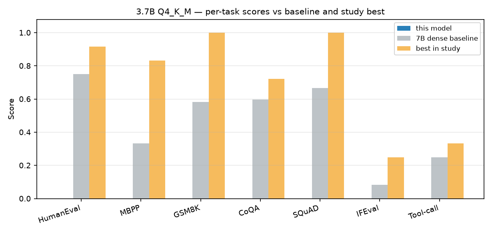

# 3.7B Q4_K_M

`user.K2-3.7B-Q4_K_M` · 3.7B dense · 2.94 GiB

**7.46 tok/s** decode · 13.0 tok/s prefill

## Per-test results

| Test | Metric | Score | ± stderr | n | in mean |
|---|---|---|---|---|---|
| HumanEval | `pass@1,create_test` | — | .131 | 12 | yes |
| MBPP | `pass_at_1,none` | — | .151 | 12 | yes |
| GSM8K | `exact_match,flexible-extract` | — | .149 | 12 | yes |
| CoQA | `f1,none` | — | .126 | 12 | yes |
| SQuAD | `contains,none` | — | N/A | 12 | yes |
| IFEval | `prompt_level_strict_acc,none` | — | .083 | 12 | yes |
| Tool-call (custom) | `exact_match,extract-json` | — | .000 | 12 | yes |
| BIG-bench paragraph segmentation | `exact_match,none` | .000 | .000 | 5 | no |

> **Note.** BIG-bench paragraph segmentation scored `0.00` for every model in this study, including the FP8 baseline. The metric is non-discriminating at this scale and is excluded from the mean.

## Files

| Path | Contents |
|---|---|
| `data/results.json` | consolidated lm-eval results, provenance, raw per-filter metrics |
| `data/samples.jsonl` | every evaluated item: prompt, model output, target, per-item score |
| `data/throughput.json` | fixed-prompt decode/prefill probe |

See [`SUMMARY.md`](../SUMMARY.md) for the cross-model report and [`methodology/`](../methodology/) for how these numbers were produced.