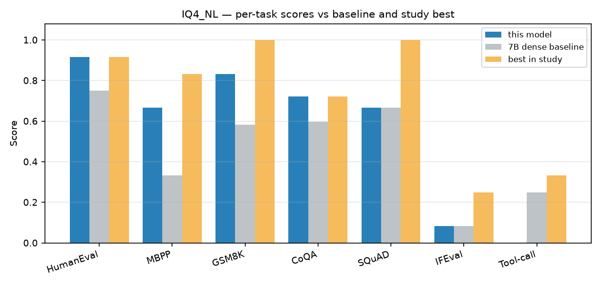

# IQ4_NL

`K2-Horizon-MoVA-36B-A4B-IQ4_NL` · 36B MoE (4B active) · 19.82 GiB

**5.09 tok/s** decode · 7.8 tok/s prefill · **mean .556** over 7 tasks

## Per-test results

| Test | Metric | Score | ± stderr | n | in mean |
|---|---|---|---|---|---|
| HumanEval | `pass@1,create_test` | .917 | .083 | 12 | yes |
| MBPP | `pass_at_1,none` | .667 | .142 | 12 | yes |
| GSM8K | `exact_match,flexible-extract` | .833 | .112 | 12 | yes |
| CoQA | `f1,none` | .722 | .090 | 12 | yes |
| SQuAD | `contains,none` | .667 | N/A | 12 | yes |
| IFEval | `prompt_level_strict_acc,none` | .083 | .083 | 12 | yes |
| Tool-call (custom) | `exact_match,extract-json` | .000 | .000 | 12 | yes |
| BIG-bench paragraph segmentation | `exact_match,none` | .000 | .000 | 5 | no |

> **Note.** BIG-bench paragraph segmentation scored `0.00` for every model in this study, including the FP8 baseline. The metric is non-discriminating at this scale and is excluded from the mean.

Mean over the 7 discriminating tasks is .556, above the 7B dense baseline's .466 (+0.090).

## Files

| Path | Contents |
|---|---|
| `data/results.json` | consolidated lm-eval results, provenance, raw per-filter metrics |
| `data/samples.jsonl` | every evaluated item: prompt, model output, target, per-item score |
| `data/throughput.json` | fixed-prompt decode/prefill probe |

See [`SUMMARY.md`](../SUMMARY.md) for the cross-model report and [`methodology/`](../methodology/) for how these numbers were produced.