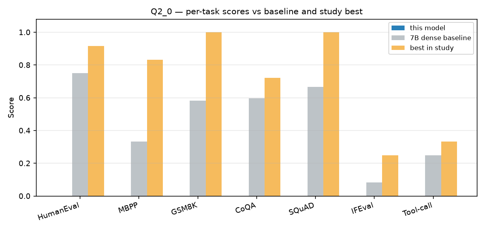

# Q2_0

`user.K2-MoVA-Q2_0` · 36B MoE (4B active) · 10.40 GiB

## Per-test results

| Test | Metric | Score | ± stderr | n | in mean |
|---|---|---|---|---|---|
| BIG-bench paragraph segmentation | `exact_match,none` | .000 | .000 | 5 | no |

> **Note.** BIG-bench paragraph segmentation scored `0.00` for every model in this study, including the FP8 baseline. The metric is non-discriminating at this scale and is excluded from the mean.

## Files

| Path | Contents |
|---|---|
| `data/results.json` | consolidated lm-eval results, provenance, raw per-filter metrics |
| `data/samples.jsonl` | every evaluated item: prompt, model output, target, per-item score |
| `data/throughput.json` | fixed-prompt decode/prefill probe |

See [`SUMMARY.md`](../SUMMARY.md) for the cross-model report and [`methodology/`](../methodology/) for how these numbers were produced.